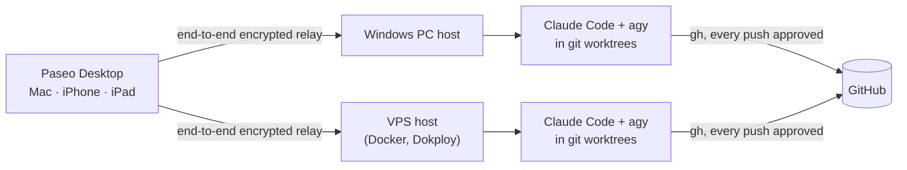
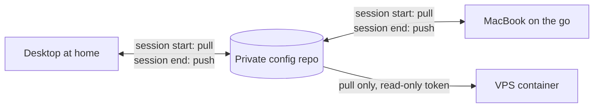
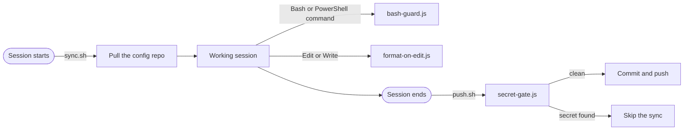

<p align="center">
  
</p>

<p align="center">
  
  
  
  
  
</p>

<p align="center">
  
  
  
  
  
</p>

<p align="center">
  <a href="INSTALL.md">Install</a> ·
  <a href="docs/paseo.md">Paseo workflow</a> ·
  <a href="docs/reference.md">Reference</a> ·
  <a href="docs/bash-guard.md">Command guard</a> ·
  <a href="plugin/skills/THIRD_PARTY_NOTICES.md">Skills</a> ·
  <a href="LICENSE">License</a>
</p>

My Claude Code configuration, and the way I code with it now: Claude plans and reviews, Gemini implements in a git worktree, and [Paseo](https://paseo.sh) runs both on my PC and on a VPS, so I can start and approve work from my phone. The stack is backend-heavy (Kotlin with Ktor, Python with FastAPI, MongoDB, Docker on a small VPS) with a React and Tailwind frontend on the side. This is the `~/.claude` directory I use every day, exported every week from my private copy without anything personal.

## 🚀 Copy this setup

Paste this into Claude Code on your machine:

```
Read https://raw.githubusercontent.com/veqzo/claude-code-setup/main/INSTALL.md and follow it to set up my machine.
```

The agent looks at your machine and projects, interviews you about your stack, shows a plan, backs up your current `~/.claude`, and then installs the plugin and writes a `CLAUDE.md`, rules and `settings.json` for your stack, not mine. Codex is supported too (skills and `AGENTS.md`). The Paseo multi-agent part is an optional last step. See [INSTALL.md](INSTALL.md).

Only want the skills, agents and hooks? Install the plugin:

```
claude plugin marketplace add veqzo/claude-code-setup
claude plugin install veqzo-setup@veqzo
```

> [!NOTE]
> The permissions, auto mode entries and rules in `setup/` are written for my stack. Let the install agent adapt them, or read them before you copy them. This is an independent personal project and is not affiliated with or endorsed by Anthropic, Google or Paseo.

## 🧭 How I code now

I no longer have one agent that does everything. I have roles, and each role goes to the model that gives the most for its quota.



| Role | Model | Paseo profile |
|---|---|---|
| Plan, debug hard problems | Claude Opus, plan mode | `planner` |
| Implement a clear plan | Gemini through the Antigravity CLI (`agy`) | `implementer`, or `implementer-fast` for one or two files |
| Implement when both Google accounts are at their cap | Claude Sonnet | `implementer-claude` |
| Review a larger diff, read only | Gemini, plan mode | `reviewer` |
| Review security, data or release diffs, read only | Claude Sonnet, plan mode | `reviewer-claude` |

**Why the split.** The Claude subscription is my bottleneck, and two Google subscriptions have room. So Claude does the work that needs judgment (plans, hard bugs, reviews), and Gemini does about 65 % of the implementation. Small changes Claude makes directly, because a brief would cost more than the change.

**A brief in, a `STATUS:` block out.** Claude hands over a brief with five parts: task, files, contract, check command and limits. Gemini works only in its own worktree, may not change tests to make them pass, never pushes, and ends with a fixed block:

```text
STATUS: done | partial | blocked
CHANGED: <file paths>
CHECK: <command> -> <pass | fail: short reason>
COMMITS: <short hashes, or none>
NOTES: <open points, risks, questions>
```

Claude runs the check again and reads the diff before anything is merged. A push or a PR is still one approval in the Claude Code dialog, which also works from the phone.

**quota-guard.** A small Paseo plugin checks the usage before each new agent. It uses the Google account I chose for that host, applies caps (90 % per Google account, 85 % / 80 % for Claude), starts the agent on the other provider when one is at its cap, and sends ntfy alerts. It never switches Google accounts by itself.

> [!WARNING]
> Google's Antigravity terms exclude headless CLI use inside third-party coding agents and automated account switching for consumer plans, and name account suspension as a possible result. Running agy inside Paseo carries that risk, also with a manual switch. Read [the details](docs/paseo.md#accounts-and-cost) and decide for your own accounts.

**One source, three agents.** I edit only `~/.claude`. `sync-agents.js` turns its `CLAUDE.md`, rules, skills, hooks and agents into the formats Codex and agy expect, so the command guard and the rules protect all of them.

**Sessions stay short.** One task per session. `/checkpoint` writes the state to `.claude/checkpoint.md`, then `/clear`, and the next session (or another agent) continues from there.

The full setup, step by step for both hosts, is in [docs/paseo.md](docs/paseo.md).

## 🎯 Why I built it

I work on a Windows desktop at home, a MacBook on the go, and now a VPS that keeps working when the desktop sleeps. I wanted every agent to behave the same everywhere. Same rules, same permissions, same hooks, without rebuilding anything by hand.

So the whole `~/.claude` directory is a git repository. A hook pulls it when a session starts, and another one commits and pushes it when the session ends. The VPS container only pulls, with a read-only token, so an agent there can never change the shared config.



Two things followed from that:

- **One setup, three operating systems.** The hooks are plain Node scripts that never go through a shell, and the permission rules exist for both the Bash and the PowerShell tool, so nothing depends on which machine I'm sitting at.
- **An unattended push has to be safe.** A hook that publishes on its own is only as safe as what it is allowed to publish. The `.gitignore` is a whitelist (everything is ignored unless I list it), and every auto-sync commit goes through a secret scan first.

This repository is built from that private one by a weekly GitHub Action. It copies the config, removes private values, and blocks the export if it finds a secret, a private domain, a hoster name or a local user path.

## 📦 What's inside

| | |
|---|---|
| 🧩 `plugin/` | The plugin `veqzo-setup`: 10 skills, one subagent, `/verify`, the hooks and a band above the prompt. It installs with one command and updates itself. |
| 🧰 `plugin/skills/` | Matt Pocock's skills for domain modeling, grilling, research and writing for agents, impeccable and apple-design for UI work, and my own `checkpoint`, `ship` and `release`. Each one keeps its license. |
| 🤖 `plugin/agents/` | A read-only security reviewer. Planning happens in plan mode or in the Paseo `planner`, reviews in `/code-review` or the Paseo reviewers. |
| ⌨️ `plugin/commands/` | `/verify`: build, types, lint, tests, secret scan and git status for the detected stack. |
| 🪝 `plugin/scripts/` | Node hooks that guard commands, block reads of real `.env` files, scan commits for secrets and format edited files. |
| 📌 `setup/CLAUDE.md` | Short global preferences: stack, GitHub handling, the routing between Claude and Gemini, session rules. |
| 📏 `setup/rules/` | Eleven rules. Three general ones are always loaded; eight are scoped with `paths:` (Python, Kotlin, MongoDB, Docker, frontend, UI design, security, testing) and load only when a matching file is touched. |
| ⚙️ `setup/settings.json` | Permissions (deny, ask, allow), auto mode environment, plugins and model settings. |
| 🛰️ `setup/paseo/` | Paseo config sources for both hosts, and the quota-guard and GitHub repo access plugins. |
| 🐳 `setup/docker/paseo-vps/` | The VPS host: Dockerfile, compose file for Dokploy, bootstrap and apply scripts. |
| 🔄 `setup/scripts/` | `sync-agents.js` for Codex and agy, the apply scripts, the Paseo config builder, and the optional sync of `~/.claude` with a secret gate. |

## 💡 Ideas worth borrowing

**Route work by quota, not by habit.** Write down which model does which job, and put it in `CLAUDE.md`, so the main session follows it. Mine: Opus plans, Sonnet is the default and the fallback, Gemini implements and does the first review. A fixed report format (`STATUS:`) makes the hand-back cheap to check.

**Keep the always-loaded part small.** `CLAUDE.md` and the three general rules come to about 2k tokens. Anything stack-specific lives in a rule with a `paths:` list in its frontmatter, so the Python rules cost nothing while I'm working on a Kotlin service.

**Ship skills as a plugin, settings as files.** A plugin can carry skills, agents, commands and hooks, and it updates itself. It cannot carry rules, permissions or auto mode settings, so those live in `setup/` and become your own files after the install.

**Write hooks in Node, without a shell.** The same scripts run on Windows, macOS and Linux, and with normalized input and output also in Codex and agy. `bash-guard.js` blocks the usual disasters (force pushes, recursive deletes of root-like paths, `curl | sh`, dropping a database) and scans the staged changes for secrets before every `git commit`. It also blocks shell reads of real `.env` files, while `.env.example` stays readable. It reports file, line and pattern, never the value. [How it works](docs/bash-guard.md).

**Make auto-sync fail closed.** Because the session-end commit would bypass the guard above, `secret-gate.js` runs the same scanner first. If it finds something, or breaks, the sync is skipped and nothing leaves the machine.

**Order permissions as deny, ask, allow.** Destructive and outward-facing commands ask first, routine safe ones run without a prompt, and secrets are off limits. Pattern matching on command text is not a security boundary, which is why the hook above exists as a second layer.

**Make approvals explicit and small.** A push, a PR change and a merge are three separate approvals. `/ship` approves exactly one push of the current feature branch, never `main` or `master`, never a force push. Production deploys stay manual.

**Generate configs you should not edit by hand.** The Paseo config is built from commented JSONC sources, checked against a pinned schema, and written only while the daemon is stopped. The apply script shows a preview first and never stops Paseo itself.

**Give UI work a ban list.** `rules/ui-design.md` loads only for frontend files and lists the usual AI tells (gradient text, nested cards, emoji icons, indigo-to-pink everything). It points to the [impeccable](https://github.com/pbakaus/impeccable) skill for critique and to real screenshots at two widths.

**Sync only on the sync branch.** `sync.sh` and `push.sh` do nothing unless the config repo is on `master`, so a review branch never gets auto-commits or a rebase in the middle of hand-made changes.

## 🔌 How the hooks fit together



## 🛡️ See it work

This is the output of `bash-guard.js`, rendered from a real run. Each command is sent to the hook the way Claude Code would send it, and the third one commits a file that contains a fake token.

<p align="center">
  
</p>

The message goes back to the agent, so it usually reacts by choosing a safer command or asking me, instead of retrying the same one.

<details>
<summary>Text version of the same run</summary>

```
$ git push --force origin main
Blocked by bash-guard: force push.
Force pushes rewrite shared history. Ask the user to run it themselves.
[exit 2]

$ rm -rf ~
Blocked by bash-guard: recursive delete of a root-like path.
Delete a specific subdirectory instead.
[exit 2]

$ git commit -m "add config"
Blocked by bash-guard: possible secrets in the changes to be committed (values are not shown):
  - config.py:1  GitHub token
Remove them, load them from environment variables (OpenBao/.env), and rotate any secret that was ever pushed.
For an intentional test fixture, add the comment "secret-scan:allow" on that line.
[exit 2]

$ git status
[exit 0]
```

</details>

## 🗂️ Layout

```
.
├── INSTALL.md          prompt for an agent that installs this setup
├── .claude-plugin/     marketplace "veqzo"
├── plugin/             plugin "veqzo-setup"
│   ├── skills/         10 skills with their licenses
│   ├── agents/         security reviewer
│   ├── commands/       /verify
│   ├── hooks/          hooks.json and the band above the prompt
│   └── scripts/        bash-guard, format-on-edit, shared helpers with tests
├── setup/              goes into ~/.claude, adapted by the install agent
│   ├── CLAUDE.md       global preferences and routing, always loaded
│   ├── rules/          general rules, plus per-stack rules scoped with paths:
│   ├── settings.json   permissions, auto mode, plugins, model
│   ├── paseo/          Paseo config sources, schema, quota-guard and repo access plugins
│   ├── docker/         the Paseo VPS container
│   ├── scripts/        agent sync, apply scripts, Paseo config builder, optional sync hooks
│   └── settings.sync-hooks.json, claude-dir.gitignore   optional sync
└── docs/               Paseo workflow, reference, command guard, images
```

## 🧪 Try the guard

Run this in a normal terminal, not through Claude with the hook enabled, because the guard would block the command that contains the test string. It should print `2`:

```sh
node -e "
const { spawnSync } = require('child_process');
const command = 'git push --' + 'force';
const r = spawnSync('node', ['plugin/scripts/hooks/bash-guard.js'], { input: JSON.stringify({ tool_input: { command } }), encoding: 'utf8' });
console.log(r.status);"
```

The full details, including the permission lists and the hook behaviour, are in [`docs/reference.md`](docs/reference.md).

## 📄 Credits and license

My own work here is released under the [MIT License](LICENSE). It comes with no warranty, so read any hook that runs commands or pushes to git before you enable it.

Parts of `plugin/agents/` and `plugin/commands/verify.md` started from [everything-claude-code](https://github.com/affaan-m/ECC) by Affaan Mustafa, which is also MIT licensed. Its notice is kept in [`THIRD_PARTY_NOTICES.md`](THIRD_PARTY_NOTICES.md). The skills in `plugin/skills/` belong to their authors and are redistributed under their licenses (MIT and Apache-2.0). Each skill folder keeps its license file, and [`plugin/skills/THIRD_PARTY_NOTICES.md`](plugin/skills/THIRD_PARTY_NOTICES.md) lists the upstream, commit and license of each one. [Paseo](https://paseo.sh) and the Antigravity CLI are separate products of their makers.
