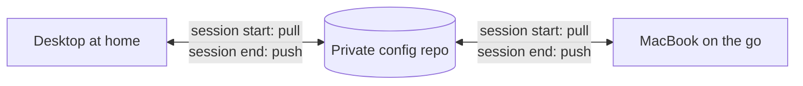
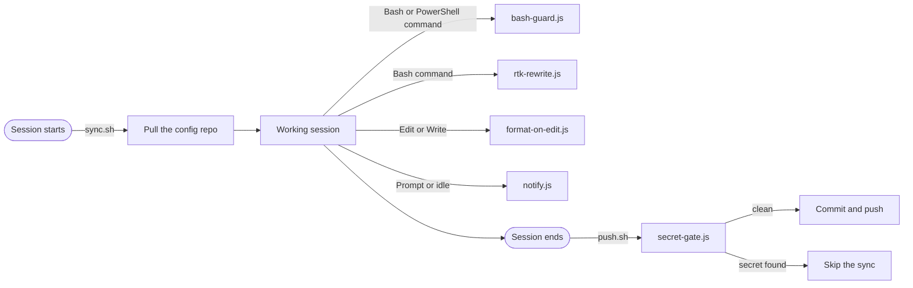

<p align="center">
  
</p>

<p align="center">
  
  
  
  
</p>

<p align="center">
  
  
  
  
  
</p>

<p align="center">
  <a href="INSTALL.md">Install</a> ·
  <a href="docs/reference.md">Reference</a> ·
  <a href="docs/bash-guard.md">Command guard</a> ·
  <a href="plugin/skills/THIRD_PARTY_NOTICES.md">Skills</a> ·
  <a href="LICENSE">License</a>
</p>

My Claude Code configuration: skills, rules, subagents, hooks and permissions for a backend-heavy stack (Kotlin with Ktor, Python with FastAPI, MongoDB, Docker on a small VPS) with a React and Tailwind frontend on the side. It is the `~/.claude` directory I use every day, exported every week from my private copy without anything personal.

## 🚀 Copy this setup

Paste this into Claude Code on your machine:

```
Read https://raw.githubusercontent.com/veqzo/claude-code-setup/main/INSTALL.md and follow it to set up my machine.
```

The agent looks at your machine and projects, interviews you about your stack, shows a plan, backs up your current `~/.claude`, and then installs the plugin and writes a `CLAUDE.md`, rules and `settings.json` for your stack, not mine. Codex is supported too (skills and `AGENTS.md`). See [INSTALL.md](INSTALL.md).

Only want the skills, agents and hooks? Install the plugin:

```
claude plugin marketplace add veqzo/claude-code-setup
claude plugin install veqzo-setup@veqzo
```

> [!NOTE]
> The permissions, auto mode entries and rules in `setup/` are written for my stack. Let the install agent adapt them, or read them before you copy them. This is an independent personal project and is not affiliated with or endorsed by Anthropic.

## 🎯 Why I built it

I work on two machines: a Windows desktop at home and a MacBook when I'm on the go. I wanted Claude Code to behave exactly the same on both. Same rules, same subagents, same permissions, same hooks, without rebuilding anything by hand and without wondering why a command is allowed on one machine and blocked on the other.

So the whole `~/.claude` directory is a git repository. A hook pulls it when a session starts, and another one commits and pushes it when the session ends. If I change a rule on the desktop, the MacBook has it the next time I open Claude Code.



Two things followed from that:

- **One setup, two operating systems.** The hooks are plain Node scripts that never go through a shell, and the permission rules exist for both the Bash and the PowerShell tool, so nothing depends on which machine I'm sitting at. I run it on both, and the hooks, the sync and the notification sound all work on each.
- **An unattended push has to be safe.** A hook that publishes on its own is only as safe as what it is allowed to publish. The `.gitignore` is a whitelist (everything is ignored unless I list it), and every auto-sync commit goes through a secret scan first.

This repository is built from that private one by a weekly GitHub Action. It copies the config, removes private values, and blocks the export if it finds a secret, a private domain or a local user path.

## 📦 What's inside

| | |
|---|---|
| 🧩 `plugin/` | The plugin `veqzo-setup`: 19 skills, four subagents, `/verify`, the hooks and a band above the prompt. It installs with one command and updates itself. |
| 🧰 `plugin/skills/` | The skills I use: Matt Pocock's engineering skills (TDD, debugging, design, grilling, specs), impeccable and frontend-design for UI work, apple-design. Each one keeps its upstream license. |
| 🤖 `plugin/agents/` | Code reviewer, read-only security reviewer, test-first guide and cleanup. Planning happens in plan mode, not in an agent. |
| ⌨️ `plugin/commands/` | `/verify`: build, types, lint, tests, secret scan and git status for the detected stack. |
| 🪝 `plugin/scripts/` | Node hooks that guard commands, block reads of real `.env` files, scan commits for secrets, compress command output with rtk, format edited files and play a sound. |
| 📌 `setup/CLAUDE.md` | Short global preferences: stack, tooling, how I want GitHub handled. |
| 📏 `setup/rules/` | Eleven rules. Three general ones are always loaded; eight are scoped with `paths:` (Python, Kotlin, MongoDB, Docker, frontend, UI design, security, testing) and load only when a matching file is touched. |
| ⚙️ `setup/settings.json` | Permissions (deny, ask, allow), auto mode environment, plugins and model settings. |
| 🔄 `setup/scripts/` | Optional sync of `~/.claude` with your own private repo, with a secret gate before every auto-commit. |

## 💡 Ideas worth borrowing

**Keep the always-loaded part small.** `CLAUDE.md` and the three general rules come to about 1.5k tokens. Anything stack-specific lives in a rule with a `paths:` list in its frontmatter, so the Python rules cost nothing while I'm working on a Kotlin service.

**Ship skills as a plugin, settings as files.** A plugin can carry skills, agents, commands and hooks, and it updates itself. It cannot carry rules, permissions or auto mode settings, so those live in `setup/` and become your own files after the install.

**Write hooks in Node, without a shell.** The same scripts run on Windows and macOS. `bash-guard.js` blocks the usual disasters (force pushes, recursive deletes of root-like paths, `curl | sh`, dropping a database) and scans the staged changes for secrets before every `git commit`. It also blocks shell reads of real `.env` files (`cat`, `grep`, `Get-Content`, `cp`, and the same through `rtk read`), while `.env.example` stays readable. It reports file, line and pattern, never the value. [How it works](docs/bash-guard.md).

**Make auto-sync fail closed.** Because the session-end commit would bypass the guard above, `secret-gate.js` runs the same scanner first. If it finds something, or breaks, the sync is skipped and nothing leaves the machine.

**Order permissions as deny, ask, allow.** Destructive and outward-facing commands ask first, routine safe ones run without a prompt, and secrets are off limits. Pattern matching on command text is not a security boundary, which is why the hook above exists as a second layer.

**Compress command output, but keep the prompts.** `rtk-rewrite.js` hands Bash calls to [rtk](https://github.com/rtk-ai/rtk), which rewrites `git status` to `rtk git status` and returns much shorter output. Commands that match an `ask` rule are left alone, because `rtk git stash drop` would no longer match `Bash(git stash drop*)` and the confirmation would silently disappear. Every git, docker and curl deny rule is mirrored with an `rtk ` prefix, and rtk telemetry is off (`scripts/rtk/config.toml`). Without rtk installed the hook does nothing.

**Give UI work a ban list.** `rules/ui-design.md` loads only for frontend files and lists the usual AI tells (gradient text, nested cards, emoji icons, indigo-to-pink everything). It points to the [impeccable](https://github.com/pbakaus/impeccable) skill for critique and to real screenshots at two widths, and keeps impeccable's per-edit hook off.

**Sync only on the sync branch.** `sync.sh` and `push.sh` do nothing unless the config repo is on `master`, so a review branch never gets auto-commits or a rebase in the middle of hand-made changes.

**Pick the model per job.** Sonnet is the default for the main session and every subagent, Haiku for pure file search, and Opus only for the security reviewer on changes that touch auth, secrets or exposed infra. The security reviewer is read-only (no Write or Edit tools). Aliases instead of pinned model IDs keep the setup from going stale.

## 🔌 How the hooks fit together



## 🛡️ See it work

This is the output of `bash-guard.js`, rendered from a real run. Each command is sent to the hook the way Claude Code would send it, and the third one commits a file that contains a fake token.

<p align="center">
  
</p>

The message goes back to Claude, so it usually reacts by choosing a safer command or asking me, instead of retrying the same one.

<details>
<summary>Text version of the same run</summary>

```
$ git push --force origin main
Blocked by bash-guard: force push.
Force pushes rewrite shared history. Ask the user to run it themselves.
[exit 2]

$ rm -rf ~
Blocked by bash-guard: recursive delete of a root-like path.
Delete a specific subdirectory instead.
[exit 2]

$ git commit -m "add config"
Blocked by bash-guard: possible secrets in the changes to be committed (values are not shown):
  - config.py:1  GitHub token
Remove them, load them from environment variables (Phase/.env), and rotate any secret that was ever pushed.
For an intentional test fixture, add the comment "secret-scan:allow" on that line.
[exit 2]

$ git status
[exit 0]
```

</details>

## 🗂️ Layout

```
.
├── INSTALL.md          prompt for an agent that installs this setup
├── .claude-plugin/     marketplace "veqzo"
├── plugin/             plugin "veqzo-setup"
│   ├── skills/         19 third-party skills with their licenses
│   ├── agents/         subagents
│   ├── commands/       /verify
│   ├── hooks/          hooks.json and the band above the prompt
│   └── scripts/        bash-guard, rtk-rewrite, format-on-edit, notify, shared helpers with tests
├── setup/              goes into ~/.claude, adapted by the install agent
│   ├── CLAUDE.md       global preferences, always loaded
│   ├── rules/          general rules, plus per-stack rules scoped with paths:
│   ├── settings.json   permissions, auto mode, plugins, model
│   ├── settings.sync-hooks.json, claude-dir.gitignore, scripts/   optional sync
│   └── scripts/rtk/    rtk config: telemetry off, gh excluded
└── docs/               reference, command guard, images
```

## 🧪 Try the guard

Run this in a normal terminal, not through Claude with the hook enabled, because the guard would block the command that contains the test string. It should print `2`:

```sh
node -e "
const { spawnSync } = require('child_process');
const command = 'git push --' + 'force';
const r = spawnSync('node', ['plugin/scripts/hooks/bash-guard.js'], { input: JSON.stringify({ tool_input: { command } }), encoding: 'utf8' });
console.log(r.status);"
```

The full details, including the permission lists and the hook behaviour, are in [`docs/reference.md`](docs/reference.md).

## 📄 Credits and license

My own work here is released under the [MIT License](LICENSE). It comes with no warranty, so read any hook that runs commands or pushes to git before you enable it.

Parts of `plugin/agents/` and `plugin/commands/verify.md` started from [everything-claude-code](https://github.com/affaan-m/ECC) by Affaan Mustafa, which is also MIT licensed. Its notice is kept in [`THIRD_PARTY_NOTICES.md`](THIRD_PARTY_NOTICES.md). The skills in `plugin/skills/` belong to their authors and are redistributed under their licenses (MIT and Apache-2.0). Each skill folder keeps its license file, and [`plugin/skills/THIRD_PARTY_NOTICES.md`](plugin/skills/THIRD_PARTY_NOTICES.md) lists the upstream, commit and license of each one.
